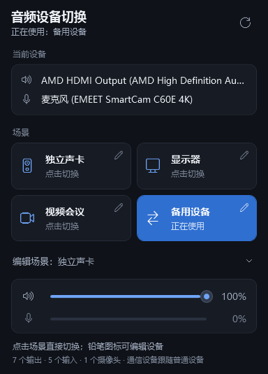

# 音频设备切换面板 · Audio Scene Switcher

Windows 托盘小工具：把常用的输出、输入设备组合存成“场景”，点一下同时切换系统默认的普通设备和通信设备，并显示音量和麦克风电平。

A Windows tray app that switches the default audio output/input devices (including the communications role) by scene in one click.



## 功能

- **一键切换场景**：内置“独立声卡 / 显示器 / 视频会议 / 备用设备”四个场景，点击卡片即切换；名称和设备都可以修改。
- **同时切换六个默认角色**：输出、输入各自的 Console、Multimedia、Communications 一起切换，会议软件也跟着走；也可以让通信设备单独指定。
- **切换失败自动回滚**：逐个角色写入并回读核验，中途失败会恢复已改动的设备，且不覆盖其他程序在此期间做的更改。
- **首次启动自动识别**：按设备名识别独立/外置声卡、HDMI/DisplayPort 显示器音频和摄像头麦克风，认不出的场景留空待配置，不乱猜。
- **托盘常驻**：单击托盘图标打开面板，右键菜单可直接切换场景；可设置登录后自动在托盘运行（不会自动切换设备）。
- **音量与电平**：系统输出音量、静音，以及当前麦克风的实时输入电平。
- **摄像头偏好**：为每个场景记录想用的摄像头，提醒自己在会议软件里选择（Windows 没有全局默认摄像头）。

## 下载安装

到 [Releases](../../releases) 下载 `AudioPanel-Setup-<版本>.exe`，双击安装。

- 系统要求：Windows 10 1809 及以上 / Windows 11，x64；安装包自带 .NET 运行时，无需另装。
- 按当前用户安装到 `%LOCALAPPDATA%\Programs\AudioPanel`，不需要管理员权限。
- 安装包没有代码签名，首次运行时 SmartScreen 可能提示“未知发布者”，点“更多信息 → 仍要运行”即可。
- 卸载：在“设置 → 应用”中卸载。会删除开机启动项，保留场景配置，重新安装后可继续使用。

## 使用

1. 打开面板（单击托盘图标），点场景卡片右上角的铅笔图标，设置这个场景的名称、输出、输入和摄像头。修改会自动保存，但不会立即切换设备。
2. 点击场景卡片即切换。当前生效的场景高亮显示；如果几个场景设备相同，只点亮最后切换的那个。
3. 需要会议软件使用不同的设备时，取消勾选“通信设备跟随普通设备”，再分别选择通信输出和通信输入。

面板打开时会以共享模式打开当前麦克风来读取电平（不独占，不影响其他程序），任务栏可能显示“麦克风正在使用”；隐藏面板后立即释放。

## 安全边界

只有点击场景卡片、“应用场景”按钮或托盘菜单中的场景，才会改变系统默认设备；编辑场景只保存配置。摄像头选择只是偏好记录，不代表微信、腾讯会议或浏览器已经切换摄像头。

日常列表只包含状态为 Active 的端点。切换使用端点 ID，名称只用于显示；驱动升级或重装可能产生新的端点 ID，此时需要重新选择场景设备。

## 配置和日志

- 配置：`%LOCALAPPDATA%\AudioPanel\config.json`
- 日志：`%LOCALAPPDATA%\AudioPanel\audio-panel.log`
- 损坏配置会备份为 `config.json.bad-时间戳.json` 并恢复默认值
- 开机启动项：`HKCU\Software\Microsoft\Windows\CurrentVersion\Run` 下的 `AudioPanel`

## 构建

需要 .NET 10 SDK。工程没有第三方 NuGet 依赖。

```powershell
dotnet build .\AudioPanel.csproj -c Release
dotnet run --project .\tools\AudioPanel.SelfTests     # 场景切换事务自测（模拟音频）
dotnet run --project .\tools\AudioPanel.UiTests       # WPF 界面回归（模拟音频）
dotnet run --project .\tools\AudioPanel.Diagnostics   # 只读设备诊断
```

- 自测和界面回归使用模拟音频，配置与日志写入临时目录。界面回归需要正常 Windows 用户令牌，以验证当前用户命名管道。
- 诊断程序默认只读；显式传入 `--probe-switch` 时才会临时切换 Multimedia 输出与输入角色并立即恢复。
- `--smoke` / `--render-smoke` 用于启动和界面渲染验证，不应用任何场景。可用 `AUDIO_PANEL_DATA_DIRECTORY` 指定隔离的配置目录，`AUDIO_PANEL_SCREENSHOT` 指定截图输出；`build-preview.cmd` 会编译并生成一张界面截图。

### 生成安装包

安装 [Inno Setup 6](https://jrsoftware.org/isinfo.php)（`winget install JRSoftware.InnoSetup`）后双击 `build-installer.cmd`：按 `AudioPanel.csproj` 中的版本号发布自带运行时的单文件程序，并生成 `artifacts\installer\AudioPanel-Setup-<版本>.exe`。安装脚本在 `installer\`。

## 当前限制

- 默认设备的写入使用 Windows 未公开的 PolicyConfig 接口，Windows 大版本更新后需要回归验证；
- Windows 没有所有桌面应用共同遵守的默认摄像头；
- 场景固定为四个，暂不支持增删；界面只有中文；
- 未实现单独应用音频路由和蓝牙连接后自动切换。

## 许可证

[MIT](LICENSE)
